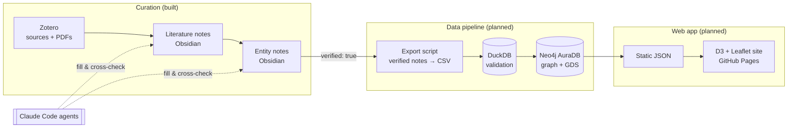

# Tea Bioinformatics

A public knowledge graph (Neo4j/Cypher) reconciling Taiwanese tea cultivar genetics from
fragmented literature, institutional records, and vernacular naming — delivered as a map and
lineage explorer anyone can use.

| | |
|---|---|
| **Status** | Pre-MVP · data-curation phase (literature layer complete, entity layer started) |
| **Next milestone** | M5 — MVP entity set (15–25 cultivars, 6–10 regions, *C. formosensis*) |
| **Pace** | ~3 hours/week, single researcher |
| **Start here** | [Operating workflow](docs/workflow.md) · [Project proposal](docs/tea-heritage-kg-proposal.qmd) |

## The problem

Tea in Taiwan exists in three genetically and historically distinct lineages — wild endemic
*Camellia formosensis*, introduced/naturalized Assamica-type tea, and institutionally bred
cultivars (TTES No. 1–25+) developed by the Tea Research and Extension Station (TRES) since
1903. The science is real and rigorous, but scattered across:

- peer-reviewed molecular studies, each with its own inconsistent identifier system;
- institution-only web pages in English and Chinese with no machine-readable export;
- vernacular names that don't map 1:1 onto official cultivar numbers (e.g. Jin Xuan is both
  TTES No. 12 and breeding code 2027).

No one has reconciled these into one internally consistent, queryable structure that is honest
about where sources disagree. **That reconciliation — entity resolution with provenance — is
this project's contribution**, not the tea itself.

## Deliverables

| Deliverable | Priority | Description |
|---|---|---|
| Public web app | Primary | Static site with four pages: **Map** of tea regions, **Lineage Explorer** (D3 network of breeding ancestry), **Species Deep Page** for *C. formosensis*, **About/Methodology** disclosing sources and unresolved disagreements |
| Open dataset | Secondary | Validated CSVs + graph, archived on Zenodo with a data dictionary |
| Manuscript | Optional | Methods paper on representing source disagreement in a knowledge graph |

MVP scope (proposal §5.6): 6–10 regions, 15–25 cultivars with immediate parentage, one species
page, and a complete About page.

## Architecture



| Layer | Technology | Role |
|---|---|---|
| Capture | Zotero + Better BibTeX | Source library, citekeys, PDFs |
| Curation | Obsidian (Zotero Integration, Templater, Dataview) | Literature notes and entity notes as YAML-frontmatter Markdown |
| Automation | Claude Code skills + subagents (Codex-compatible), markitdown | PDF → text, grounded extraction, conflict detection |
| Staging | DuckDB, pandas (Python 3.12, uv) | Referential-integrity and duplicate-ID checks in SQL |
| Graph | Neo4j AuraDB Free, Cypher, GDS | Lineage graph; every relationship carries `source` + `confidence` |
| Presentation | D3.js, Leaflet, GitHub Pages | Pre-computed static site, no live backend |

### Data model (MVP)

```
Species         {scientific_name, chinese_name, iucn_status, first_described_year}
Cultivar        {ttes_number, breeding_code, name_zh, name_en, year_released, purpose}
ParentGermplasm {name, origin_country, taxonomic_type}
Region          {name, county, elevation_min_m, elevation_max_m}
Institution     {name, abbreviation, founded_year}

(:Cultivar)-[:BRED_FROM {source, confidence}]->(:ParentGermplasm | :Cultivar)
(:Cultivar)-[:DERIVED_FROM_SPECIES {source, confidence}]->(:Species)
(:Cultivar)-[:GROWN_IN {source}]->(:Region)
(:Species)-[:FOUND_IN {source, population_status}]->(:Region)
(:Institution)-[:DEVELOPED {source}]->(:Cultivar)
```

Disputed facts are stored as **separate relationships, one per source**, never collapsed into
a single answer. Full rationale: proposal §3.4.

## Progress

### Milestones

| # | Milestone | Status | Date / evidence |
|---|---|---|---|
| M0 | Proposal, tech-stack and cost analysis | ✅ Done | [`tea-heritage-kg-proposal.qmd`](docs/tea-heritage-kg-proposal.qmd) |
| M1 | Literature acquisition, citation-gap and synonym resolution | ✅ Done | 2026-07-09 · [progress report](research_journal/progress-report-tagging-phase.md) |
| M2 | Literature layer: 12 sources imported, extracted, cross-checked | ✅ Done | 2026-08-07 · [`note_journal_map.md`](docs/note_journal_map.md) |
| M3 | Agent workflow: 3 skills + 3 subagents for extraction, entities, conflicts | ✅ Done | 2026-11-06 · [`workflow.md`](docs/workflow.md) |
| M4 | Schema diagram + data dictionary | 🟡 Drafted | Schema in proposal §3.4; diagram and dictionary not yet produced |
| M5 | MVP entity set reviewed (`verified: true`) | 🟡 In progress | 1 species note drafted, 0 verified |
| M6 | Export script + DuckDB validation | ⬜ Not started | — |
| M7 | Neo4j load with provenance | ⬜ Not started | — |
| M8 | Web app MVP live on GitHub Pages | ⬜ Not started | — |
| M9 | Zenodo dataset / manuscript | ⬜ Optional | — |

### Current metrics

| Measure | Now | MVP target |
|---|---|---|
| Literature notes (extracted · conflicts checked) | 12 · 12 | 8–10 core sources |
| Species notes (drafted · verified) | 1 · 0 | 1 |
| Cultivar notes | 0 | 15–25 |
| Region notes | 0 | 6–10 |
| Records in graph | 0 | 40–60 |

**Effort.** The proposal estimates ~60 hours to MVP (§6.2), about 20 weeks at 3 h/week.
Literature sweep and conceptual notes (~9 h of that) are complete and extraction is partly
done, so roughly **45–50 hours remain** *[estimate]*, about 4 months at the current pace.

### Open issues and risks

| Item | Impact | Plan |
|---|---|---|
| `ParentGermplasm` (e.g. Burma accession B-729) has no entity template | Parentage for TTES No. 18/24 can't be modeled yet | Add a template, or represent as Cultivar/Species before M6 |
| Synonym map (10 wild-tea populations) lives only in the progress report | Entity resolution depends on it | Create `synonym-map.md` in the vault |
| Follow-ups from the 2026-07-09 report (Wang & Ho 1997, Yu et al. 2019 not yet in Zotero) | Gaps in parentage and synonym provenance | Import, then run the workflow |
| Senshan and Sun Cha names unresolved | Possible duplicate or missing nodes | Deferred; flag as open questions |
| Duplicate Zotero items (see map's orphan section) | Noise in scans only | Dedupe in Zotero |
| Agent extraction can mis-state facts | Data integrity | Human review gate: only `verified: true` is exported |
| Templater folder auto-trigger unavailable | One extra command per manual entity note | Agent creates notes directly |

## How the work runs

Sources go through a staged pipeline with a human gate at the end; agents do the bulk reading
and drafting:

1. **Capture** a source in Zotero and **import** its literature note in Obsidian *(human)*.
2. **Extract** the paper into its note — `refresh-literature-notes` *(agent)*.
3. **Create / fill entity notes** from the literature — `fill-entity-note` *(agent)*.
4. **Record conflicts** between sources in both notes — `cross-check-sources` *(agent)*.
5. **Review** and flip `verified: true` — the export gate *(human)*.

➡ **Full procedure, definitions of done, status fields, and agent architecture:
[`docs/workflow.md`](docs/workflow.md)**

## Repository layout

```
Sources/Literature-Notes/   One literature note per source (citekey.md)
Entities/                   Entity notes: Cultivars, Species, Regions, Institutions
_templates/                 Literature template (Zotero Integration) + Notes/ entity templates (Templater)
docs/
  workflow.md                 Operating workflow (start here for day-to-day work)
  note_journal_map.md         Citekey ↔ Zotero item/attachment ↔ PDF map
  markdown_pdf/               markitdown conversions of source PDFs (generated, gitignored)
  setup-guide/                Obsidian plugin setup and troubleshooting history
  *.qmd                       Proposal, execution guide, workflow recipe, tagging how-to
research_journal/           Phase progress reports
Tea_Taxonomy/               Working taxonomy notes
.claude/skills/, agents/    Agent skills and subagents (.agents/skills → symlink for Codex)
AGENTS.md, CLAUDE.md        Agent instructions (CLAUDE.md imports AGENTS.md)
pyproject.toml              Python deps: neo4j, pandas, duckdb (managed with uv)
```

The repository root is also an **Obsidian vault**.

## Getting started

Requirements: Python 3.12+ and [uv](https://docs.astral.sh/uv/);
[Obsidian](https://obsidian.md/); [Zotero](https://www.zotero.org/) with Better BibTeX and
the Zotero Integration plugin; [Claude Code](https://claude.com/claude-code) (or Codex) and a
local [markitdown](https://github.com/microsoft/markitdown) install for the agent workflow.

```bash
uv sync
```

Open the repo root as a vault in Obsidian, configure plugins per
[`docs/setup-guide/`](docs/setup-guide/), then follow [`docs/workflow.md`](docs/workflow.md).

## Documentation index

| Doc | Covers |
|---|---|
| [`docs/workflow.md`](docs/workflow.md) | Operating workflow: stages, roles, definitions of done, agents |
| [`docs/tea-heritage-kg-proposal.qmd`](docs/tea-heritage-kg-proposal.qmd) | Full proposal: background, objectives, methods, schema, tech stack, time/cost |
| [`docs/tea-kg-execution-guide.qmd`](docs/tea-kg-execution-guide.qmd) | Setup/execution guide: accounts, environment, literature-to-graph-to-web |
| [`docs/km-workflow-recipe.qmd`](docs/km-workflow-recipe.qmd) | Original Zotero → Obsidian → Claude Code knowledge-management recipe |
| [`docs/tagging-taxonomy-howto.qmd`](docs/tagging-taxonomy-howto.qmd) | Tagging taxonomy used across literature notes |
| [`docs/note_journal_map.md`](docs/note_journal_map.md) | Citekey ↔ Zotero ↔ PDF map |
| [`docs/setup-guide/obsidian-zotero-integration.md`](docs/setup-guide/obsidian-zotero-integration.md) | Zotero Integration setup and troubleshooting |
| [`docs/setup-guide/ENTITY-NOTE-SETUP-WALKTHROUGH.md`](docs/setup-guide/ENTITY-NOTE-SETUP-WALKTHROUGH.md) | Templater setup and manual entity-note creation |
| [`research_journal/progress-report-tagging-phase.md`](research_journal/progress-report-tagging-phase.md) | M1 phase report: citation gaps, parentage sources, synonym map |

## License

[CC BY-NC 4.0](LICENSE) — free to share and adapt for academic, research, or personal/hobby use
with attribution; commercial use is not permitted. Third-party PDFs and other primary sources
referenced by this project are not included in the repo and remain under their own copyright.

## Author

Kevin Lan
