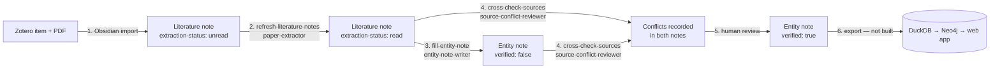

# Operating Workflow

How a source moves from Zotero to a reviewed, export-ready entity record, who does each step,
and the definition of done at each stage. For the project overview and milestones see the
[README](../README.md); for the research rationale see
[`tea-heritage-kg-proposal.qmd`](tea-heritage-kg-proposal.qmd).

---

## 1. Overview

Two note layers, each with one job:

| Layer | Location | One per | Created by | Purpose |
|---|---|---|---|---|
| Literature notes | `Sources/Literature-Notes/<citekey>.md` | Source (paper, bulletin, institutional page) | Obsidian Zotero Integration plugin | Provenance record: what *this source* says |
| Entity notes | `Entities/{Cultivars,Species,Regions,Institutions}/<Name>.md` | Future graph node | Agent (`fill-entity-note`) or Templater | Synthesis: what *all sources* say about one thing, with conflicts |

The guiding rule throughout: every claim traces to a specific source, and disagreements between
sources are recorded on both sides rather than resolved silently. Disagreements are findings
(proposal §3.4–3.5), and they become separate, source-tagged relationships in the graph.

## 2. Roles

| Actor | Responsible for |
|---|---|
| **Researcher (human)** | Choosing sources, Zotero capture, Obsidian import, reviewing agent output, resolving open questions, flipping `verified: true` |
| **Claude Code / Codex session** | Running the three skills, updating `docs/note_journal_map.md`, PDF conversion, coordinating subagents |
| **`paper-extractor`** (Sonnet) | Filling one literature note from its converted PDF only |
| **`entity-note-writer`** | Creating/filling one entity note from literature notes only |
| **`source-conflict-reviewer`** | Finding factual disagreements across a set of notes and recording them both ways |

Agents never set `verified: true` or tick "Ready to extract to CSV" — those are the human
review gates.

## 3. Prerequisites (one-time)

- Zotero with Better BibTeX and the Obsidian **Zotero Integration** plugin, configured per
  [`setup-guide/obsidian-zotero-integration.md`](setup-guide/obsidian-zotero-integration.md)
  (import format name: *Tea bioinformatics journals import*).
- Templater, with `_templates/Notes` as the template folder, per
  [`setup-guide/ENTITY-NOTE-SETUP-WALKTHROUGH.md`](setup-guide/ENTITY-NOTE-SETUP-WALKTHROUGH.md)
  (only needed for creating entity notes by hand).
- A local [markitdown](https://github.com/microsoft/markitdown) venv; default path is set in
  `.claude/skills/refresh-literature-notes/scripts/convert_pdf.sh`, override with
  `MARKITDOWN_BIN`.
- `sqlite3` on PATH and Zotero's database at `~/Zotero/zotero.sqlite` (override with
  `ZOTERO_DB`). The scan copies the database first, so Zotero can stay open.
- Claude Code (or Codex) started from the repo root. Project instructions load from
  `AGENTS.md` (imported by `CLAUDE.md`).

## 4. Stages

### Stage 1 — Capture and import a source *(human)*

1. Add the item to Zotero with its PDF attached. For web-only sources, save a PDF snapshot as
   the attachment — the pipeline reads PDFs only.
2. In Obsidian: `Cmd+P` → **Zotero Integration: Tea bioinformatics journals import** → select
   the item. Don't use the generic "Import notes" command; it bypasses the custom template.
3. The plugin creates `Sources/Literature-Notes/<citekey>.md` from
   `_templates/literature-note-template.md`, with Zotero bibliographic frontmatter and
   `extraction-status: unread`.

**Done when:** the note exists, its frontmatter shows rendered values (no `{{ }}`), and
`zotero-link` points at the item.

### Stage 2 — Fill literature notes *(agent: `refresh-literature-notes`)*

Prompt: *"refresh the literature notes"* (or name specific citekeys to re-extract).

| Step | What happens | Artifact |
|---|---|---|
| Scan | `scan_zotero_attachments.sh`, `list_note_keys.sh`, `check_broken_frontmatter.sh` | TSV listings |
| Reconcile | New notes and attachments matched by Zotero item key, not filename | — |
| Map | New rows / orphan attachments added | `docs/note_journal_map.md` |
| Convert | PDF → Markdown, skipped if the existing conversion is newer than the PDF | `docs/markdown_pdf/<citekey>.md` (gitignored) |
| Extract | One `paper-extractor` per paper, in parallel | Filled note |
| Repair | Broken `authors`/`year` frontmatter fixed from the paper's title page | Note frontmatter |

What the extractor writes: Abstract (only if empty), Key Claims, Cultivars/Species, Regions,
Methods — concrete specifics from the converted paper only; empty sections are acceptable.
It sets `extraction-status: read` and the three `*-relevant` flags, and ticks "Key claims
noted" and "Entity candidates identified". It leaves bibliographic frontmatter, Conflicts,
and Annotations alone.

**Done when:** the note is `read`, the map has its row, and the session report lists nothing
unresolved for it. Orphan or duplicate Zotero attachments are listed in the map, never deleted.

### Stage 3 — Create and fill entity notes *(agent: `fill-entity-note`)*

Prompts: *"fill the entity note for TTES No. 18"*, *"create region notes for Alishan and
Lugu"*, *"which entities are mentioned in the literature but don't have notes yet?"*

- The `_templates/Notes/<type>-template.md` files are the field spec. The agent renders them by
  hand when creating a note: `canonical-id` = type prefix + short id (`cultivar_18`,
  `species_c_formosensis`, `region_alishan`, `institution_tres`), `created` = today.
- Content comes only from literature notes, attributed inline ("per Su et al. 2009").
  `sources:` lists them as `"[[citekey]]"`.
- Conflicting sources go into `## Source Conflicts` and `conflicts:`, without choosing a winner.
- Unknowns go into `## Open Questions`. `verified` stays `false`.

Manual alternative: create the note in the entity folder, then `Cmd+P` → **Templater: Insert
Template**. See the walkthrough for the prefix pitfall (don't type `species_` at the prompt).

**Done when:** no `<% %>` or `undefined` remains, every filled field has a source, and gaps
are listed as open questions.

### Stage 4 — Record conflicts between sources *(agent: `cross-check-sources`)*

Prompt: *"cross-check sources"* (defaults to notes touched this session; say *"all notes"* for
a full pass).

A conflict is an incompatible factual claim — parentage, release year, taxonomic rank,
genetic-diversity ranking, distribution. Topical overlap isn't one; added detail is recorded as
corroboration. Each conflict is written into **both** notes with a `[[citekey]]` link and each
side's claim. Literature notes with none get "Checked YYYY-MM-DD against <scope>: no
conflicts found." Either way "Conflicts documented" is ticked.

**Done when:** every touched note's conflict section is filled or marked checked.

### Stage 5 — Human review *(researcher)*

For each entity note:

1. Spot-check claims against the cited literature notes, and those against the PDF where it
   matters (proposal §3.5 requires human verification of machine-extracted records).
2. Resolve or explicitly defer each open question.
3. Decide how each recorded conflict will be represented (both claims as separate,
   source-tagged relationships — proposal §3.4 step 5).
4. Flip `verified: true`. On literature notes, tick "Ready to extract to CSV".

`verified: true` is the export gate: nothing else reaches the dataset.

### Stage 6 — Export and build *(not built yet)*

Planned per proposal §3.5–3.7 and Part 5: an export script parses `verified: true` entity
frontmatter into one CSV per node/relationship type (`data/raw/*.csv`); DuckDB validates
referential integrity and duplicate canonical IDs; a Neo4j `MERGE` loader builds the graph
with `source` and `confidence` on every relationship; a static D3/Leaflet site is generated
from exported JSON.

## 5. Status fields reference

| Field / checkbox | Where | Set by | Meaning |
|---|---|---|---|
| `extraction-status: unread → read` | Literature note | `paper-extractor` | Body filled from the PDF |
| `lineage-` / `species-` / `region-relevant` | Literature note | `paper-extractor` | Paper discusses breeding, taxonomy, or geography |
| ☑ Key claims noted / Entity candidates identified | Literature note | `paper-extractor` | Extraction complete |
| ☑ Conflicts documented | Literature note | `source-conflict-reviewer` | Cross-check done |
| ☑ Ready to extract to CSV | Literature note | Researcher | Reviewed |
| `verified: false → true` | Entity note | Researcher | Export gate passed |

## 6. Agent architecture

| Skill (entry point) | Subagent | Model | Tools | Runs |
|---|---|---|---|---|
| `refresh-literature-notes` | `paper-extractor` | Sonnet | Read, Edit, Grep, Glob | One per paper, parallel |
| `fill-entity-note` | `entity-note-writer` | Session model | + Write | One per entity, parallel |
| `cross-check-sources` | `source-conflict-reviewer` | Session model | Read, Edit, Grep, Glob | One per pass (needs all notes in one context) |

- Skills live in `.claude/skills/`; `.agents/skills` is a symlink so Codex reads the same
  files. Agent definitions live in `.claude/agents/`.
- Each agent file is also the procedure: without subagent support (e.g. Codex), the session
  follows it directly.
- Only the session edits `docs/note_journal_map.md`; subagents edit only their own note(s).

## 7. Troubleshooting

| Symptom | Where to look |
|---|---|
| Literature note frontmatter shows `{{ }}` or errors | `setup-guide/obsidian-zotero-integration.md` |
| `authors: [, , ,]` or error text in `year:` | Run `refresh-literature-notes`; it repairs them |
| Entity note shows `<% %>`, `undefined`, or a doubled prefix | `setup-guide/ENTITY-NOTE-SETUP-WALKTHROUGH.md` §5, §7 |
| Converted text has glued words (`asaninvaluableresource`) | Expected markitdown behavior on two-column PDFs; content is intact |
| A Zotero PDF has no note | Import it in Obsidian (Stage 1); the agent won't invent citekeys |
